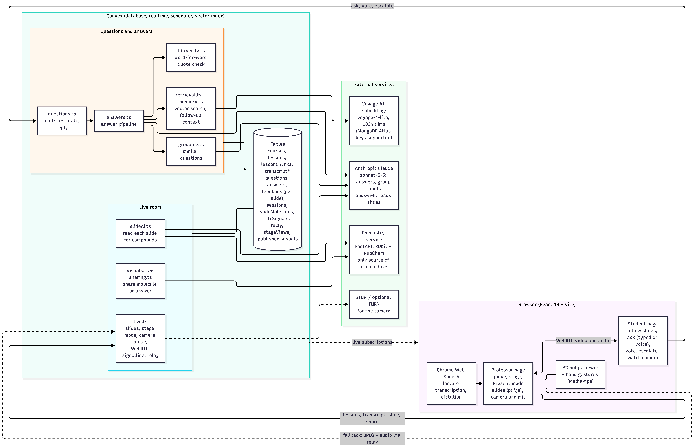

# MolViz

A live organic-chemistry classroom that runs in the browser. The professor teaches with slides, camera, questions and 3D molecules in one place. Students follow along, ask questions, and get answers taken only from the professor's own material, with every quote checked word for word.

An AI can help a professor teach in the moment, but it should never put an unchecked claim in front of students. **Claude proposes, code verifies, and the professor decides what the whole class sees.**

## The idea: one workflow, two rooms

The goal is the same on both sides of the room: the person explaining and the people listening end up with the same understanding. The classroom is the proof case. Swap the lessons for a product doc set and the student for a client, and the same workflow is a sales call where the client's doubts are cleared and they can decide, yes or no, with a clear picture of what the product does.

| In the product | Classroom | Sales call |
|---|---|---|
| Lessons and transcript | The only source of answers | Product docs, pricing, security material |
| Verified answers with quotes | Every quote checked word for word | The client is never told something the company didn't say |
| "Not covered" flag | A gap in the lesson | A gap in the collateral, so the rep answers honestly |
| Similar questions grouped | "7 students asked about acidity" | "Three buyers asked about security" |
| Per-slide votes | Where the class got lost | Where the client got lost |
| Escalate to the professor | A student who still wants a person | A client who wants the rep |

Only the classroom version is built. See `docs/pitch.md` for the pitch and the claims to avoid.

## What it does now

- **Courses and lessons.** A professor signs in with a passcode, creates a course and uploads lessons. Each is split into passages and embedded for search.
- **Live room.** A session has a join code and QR code (`/s/<CODE>`). The professor shares a PDF of slides that every student follows, and goes live with camera and mic.
- **Automatic answers.** A student's question is searched against the lessons and lecture transcript, Claude writes 2-3 sentences with quotes, and the server checks every quote. If the lesson doesn't cover it, the student is told and the professor sees it flagged first.
- **Follow-ups and similar questions.** Answers use the student's own earlier questions. Similar questions are grouped into one card with a student count.
- **Escalation.** A student can send an AI answer on to the professor, who can reply to that student directly.
- **Votes per slide.** Confused or understood, so the professor sees where the class got lost.
- **Molecules.** Claude reads each slide for the compounds on it. The professor loads any molecule by name or SMILES, highlights a functional group (RDKit finds 20 kinds) and shares it. The server re-verifies every highlight.
- **Hand gestures.** The professor can resize, rotate and move the molecule by hand (MediaPipe). Mouse and touch still work.
- **Live transcription and voice.** Chrome's speech recognition transcribes the lecture, and students can dictate questions.

The full list is in `docs/features.md`.

## Architecture



The diagram source is `docs/architecture.mmd`. Convex holds all shared state and runs every AI action. Video goes browser to browser over WebRTC, with a low-rate relay through Convex for networks that block it. The chemistry service (FastAPI, RDKit, PubChem) is the only source of atom indices, so Claude never produces a highlight.

| Layer | Technology |
|---|---|
| Backend, realtime, vector search | Convex |
| LLM | Anthropic Claude (`claude-sonnet-5-5` for answers, `claude-opus-5-5` to read slides) |
| Embeddings | Voyage AI `voyage-4-lite` (MongoDB Atlas keys supported) |
| Chemistry | FastAPI, RDKit, PubChem |
| Web app | React 19, Vite, 3Dmol.js, pdf.js |
| Gestures, speech | MediaPipe Hand Landmarker, Chrome Web Speech |
| Hosting | Vercel (web app), Render or Vercel (chemistry service) |

Design decisions and the data model are in `PROJECT_STRUCTURE.md`.

## Run it locally

You need Node 20+, `uv`, and `cloudflared` (for a local tunnel).

1. Install and start Convex (the first run asks you to log in):
   ```
   npm install
   npx convex dev
   ```
2. Set the Convex environment variables (never commit these):
   ```
   npx convex env set PROFESSOR_PASSCODE <passcode>
   npx convex env set ANTHROPIC_API_KEY <key>
   npx convex env set VOYAGE_API_KEY <key>
   ```
   Optional, so the camera reaches students behind strict firewalls: `TURN_URLS`, `TURN_USERNAME`, `TURN_CREDENTIAL`, or `METERED_DOMAIN` and `METERED_API_KEY`.
3. Start the chemistry service and publish it so Convex can reach it. `npm run tunnel` sets `CHEM_SERVICE_URL` for you:
   ```
   cd services/chem && uv sync && uv run uvicorn app.main:app --port 8000   # one terminal
   npm run tunnel                                                          # another
   ```
4. Fetch the hand model once (about 8 MB), create `apps/web/.env.local` with `VITE_CONVEX_URL=<your Convex URL>`, and start the web app:
   ```
   npm run models -w @spicy/hand-gesture
   npm run dev -w web
   ```
5. Check everything and create the demo course:
   ```
   npm run preflight
   npm run demo:seed
   ```
6. Open `/professor`, enter the passcode and open the course. Join from another window at `/s/<CODE>` and ask "Why is acetic acid acidic?". Demo slides and notes are in `samples/demo`.

Tests: `cd services/chem && uv run pytest`, `npm test -w @spicy/hand-gesture`, `npm run typecheck`. To put it online, see `docs/deploy.md`. For the demo, see `docs/demo-script.md`.

## Future work

- **Deploy for real.** Host the chemistry service and web app permanently, and try the live room (camera, relay, slide reading) on real classroom networks.
- **Measure on real data.** Re-run `scripts/eval.mjs` on a real lesson and real questions, since the answer thresholds were tuned on a synthetic one.
- **Real-world gesture testing.** The gesture logic is tested, but not yet with real hands and lighting.
- **Smarter agents.** Ideas we have discussed, not built: a router that classifies each question (new, follow-up, logistics, off-topic), a critic that checks an answer is really supported by its quotes, a professor-side suggestion agent, and a gap agent that drafts new lesson passages from uncovered questions.
- **Sales-call version.** CRM and call-platform integration, SSO, approved-content governance, audit logs and consent.
- **Known limits.** The follow-up detector is a small rule. Editing a transcript line doesn't retract answers already shown. Students are identified by a random browser id. There is no per-IP rate limit, and sessions never end.

## Safety model

Answers come only from the professor's lessons, and every quote is checked word for word before a student sees it. If the check fails or the lesson doesn't cover the question, the student is told so. Claude names the compounds on a slide but never produces a structure, and nothing unverified can be published. Professor-only data lives behind the course token.

## Third-party code

pdf.js, 3Dmol.js, RDKit, PubChemPy, Voyage AI embeddings, Convex, React, FastAPI, qrcode.react, MediaPipe Hand Landmarker. The gesture code in `packages/hand-gesture` is from the team's Molecule Gesture Lab.
